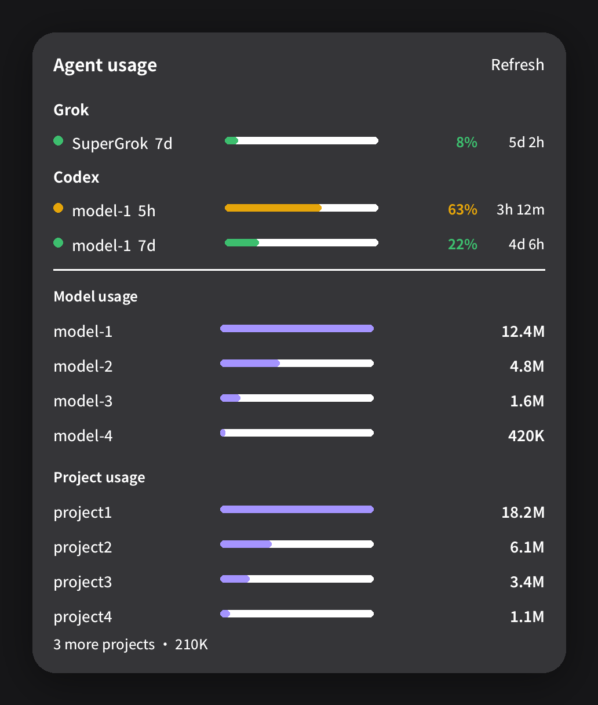

# Agent Usage

A GNOME Shell menu for AI coding agents.



Each account lists only the windows it can answer: a model or plan, then `5h` or `7d`, a bar, the percent, and the time left. Under that, usage is split by model and by project.

## Install

GNOME Shell 50.

```bash
bash scripts/package.sh
gnome-extensions install --force dist/agent-usage@fedora-enhance.shell-extension.zip
gnome-extensions enable agent-usage@fedora-enhance
```

Log out and back in once after the first install. Shell reads new extensions at startup.

## Data

The menu reads Claude, Codex, Grok, and OpenCode session logs on this computer. An existing Grok or Anthropic login is used only to ask `cli-chat-proxy.grok.com` or `api.anthropic.com` for the limit window. Session text is not uploaded, and tokens are not stored.

## License

[GPL-2.0-or-later](LICENSE)
